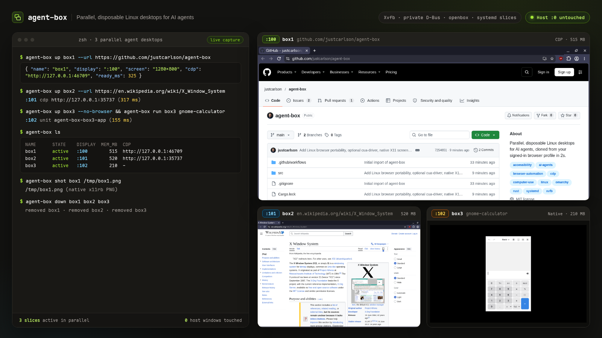
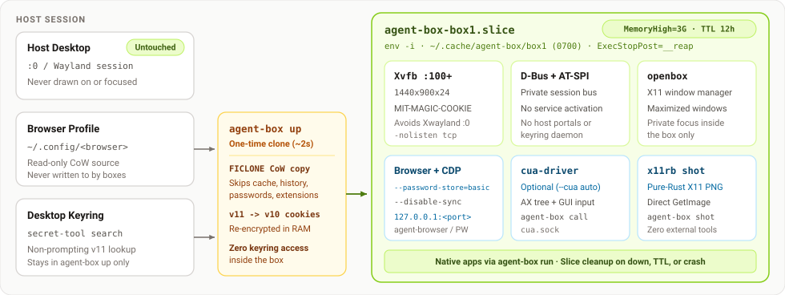

# agent-box

Parallel, disposable Linux desktops for AI agents, cloned from your signed-in browser profile in ~2 seconds. Each box runs its own headless X11 display, private D-Bus/AT-SPI bus, and window manager inside a systemd user slice so agents work side by side without touching your screen or writing back to your main browser profile.

[](https://github.com/justcarlson/agent-box/releases)
[](LICENSE)



## Quick start

```bash
agent-box up --url https://github.com                  # start a signed-in box (box1)
agent-browser --cdp "$(agent-box cdp box1)" snapshot -i # drive the browser over CDP
agent-box run box1 gnome-calculator                    # run any native Linux GUI app
agent-box shot box1 /tmp/box1.png                      # capture full-screen PNG (native x11rb)
agent-box down box1                                    # stop slice and delete all box files
```

`agent-box up` prints JSON with the box's handles (`--blank` starts without cloned cookies):

```json
{
  "name": "box1",
  "display": ":100",
  "dir": "/home/user/.cache/agent-box/box1",
  "screen": "1440x900",
  "cdp": "http://127.0.0.1:46709",
  "browser_profile": "/home/user/.config/chromium/Default",
  "clone": { "files": 184, "cookies": 1420, "cookies_dropped": 0, "key": "keyring application=chromium", "ms": 48 },
  "ready_ms": 1840
}
```

## Why `agent-box`

| Approach | Ready time | Memory | Signed in as you | Native Linux apps | Tradeoff |
| --- | --- | --- | --- | --- | --- |
| **`agent-box`** | ~0.3-2s | ~210-520 MB | Yes (CoW clone) | Yes (X11 + AT-SPI) | Linux + systemd only; same UID |
| Shared host desktop | Instant | 0 extra | Yes | Yes | Steals focus, cursor, and clipboard |
| Docker desktops / VMs | 10-60s | 1-4 GB | No (manual login) | Inside container/VM | Heavy images, re-auth friction |
| Hosted browser clouds | 2-10s | Remote | No (manual/synced) | No | Monthly cost, remote latency |

`agent-box` clones your browser profile with Linux `FICLONE` copy-on-write (skipping caches, history, saved passwords, and extensions by default) so disk overhead stays tiny. It reads your unlocked keyring secret once in memory, re-encrypts `v11` cookies to Chromium's basic `v10` key, and zeroes the secret so the boxed browser needs zero keyring access.

<picture>
  <source media="(prefers-color-scheme: dark)" srcset="docs/architecture-dark.svg">
  <source media="(prefers-color-scheme: light)" srcset="docs/architecture-light.svg">
  
</picture>

## For AI agents

Install the bundled skill:

```bash
npx skills add https://github.com/justcarlson/agent-box --skill agent-box
```

Or add two lines to `AGENTS.md` / `CLAUDE.md`:

```markdown
For signed-in web workflows or parallel GUI tasks on Linux, start an isolated desktop with `agent-box up`,
drive the browser via `agent-box cdp NAME` (or `agent-box shot`/`call`), and always clean up with `agent-box down NAME`.
```

## Install

Download a static musl binary from [GitHub Releases](https://github.com/justcarlson/agent-box/releases) (verified with `SHA256SUMS` and GitHub artifact provenance attestations), or install with Cargo:

```bash
cargo install --locked --git https://github.com/justcarlson/agent-box --tag v0.1.0
# or with cargo-binstall:
cargo binstall agent-box
```

Then run `agent-box doctor` to check host dependencies; it prints the exact `pacman`, `apt`, or `dnf` command for anything missing. On Arch, use a GitHub Release binary or `cargo install` (`aur/agent-box` is an unrelated Podman tool).

## Commands

| Command | Purpose |
| --- | --- |
| `agent-box up [NAME]` | Create a box, clone browser profile (unless `--blank`/`--no-browser`), print JSON |
| `agent-box call NAME TOOL [JSON]` | Call a `cua-driver` tool inside the box (`--shot`, `--timeout`) |
| `agent-box cdp NAME` | Print the boxed browser's `http://127.0.0.1:<port>` CDP endpoint |
| `agent-box run NAME CMD...` | Start any program inside the box's display and systemd slice |
| `agent-box open NAME URL` | Open a URL in the box's browser (starting it if needed) |
| `agent-box shot NAME [FILE]` | Save a full-screen PNG via native `x11rb` and print its path |
| `agent-box ls [--json]` | List active and stopped boxes with display, memory, and CDP URL |
| `agent-box env NAME` | Print reversible `export` lines for targeting a box from a shell |
| `agent-box gc` | Remove stopped boxes and cached profile files after a crash or reboot |
| `agent-box down NAME... \| --all` | Stop boxes atomically and delete their files |
| `agent-box doctor` | Verify host dependencies, native browser, profile, and systemd user session |

## Isolation boundary

`agent-box` provides workspace isolation, not a VM, container, or UID sandbox: boxed processes run as your Linux user account and must not be used to contain untrusted code. Each boxed browser binds an unauthenticated Chrome DevTools Protocol port on `127.0.0.1`, which other local users on a shared host can reach. Cloned cookies share server-side sessions with your host browser, so never click Sign out inside a box (use `agent-box down` instead); see [SECURITY.md](SECURITY.md) and [docs/security.md](docs/security.md).

## Documentation

| Guide | Covers |
| --- | --- |
| [docs/architecture.md](docs/architecture.md) | Systemd slice tree, locking and reaping, `:100+` displays, clean env, `x11rb` shots, measurements |
| [docs/browsers.md](docs/browsers.md) | 6-browser detection table, Snap/Flatpak checks, SQLite consistency, cookies, CDP usage |
| [docs/security.md](docs/security.md) | Threat model, `v10` disk lifetime, `SKIP` list, extension handling, multi-user CDP caveats |
| [docs/troubleshooting.md](docs/troubleshooting.md) | `doctor` package matrix, locked keyring / KWallet, `v12` cookies, cgroups, modal timeouts, logs |

Licensed under the [MIT License](LICENSE).
