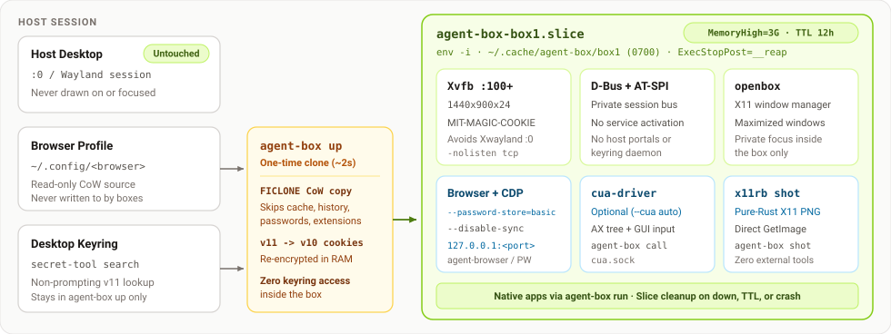

# Architecture

`agent-box` isolates each agent desktop inside a transient systemd user slice with its own headless X11 display, private D-Bus session bus, AT-SPI accessibility bus, window manager, and optional `cua-driver` daemon.

<picture>
  <source media="(prefers-color-scheme: dark)" srcset="architecture-dark.svg">
  <source media="(prefers-color-scheme: light)" srcset="architecture-light.svg">
  
</picture>

## Systemd user slice and unit tree

Every box `NAME` owns one systemd user slice (`agent-box-NAME.slice`) and at least one transient service unit:

```text
agent-box-box1.slice                       # MemoryHigh=3G, CPUWeight=50, IOWeight=50
├── agent-box-box1.service                 # `agent-box __stack box1`, RuntimeMaxSec=12h, ExecStopPost=__reap
│   ├── Xvfb :100 -displayfd 3 -nolisten tcp
│   ├── dbus-daemon --nofork (private bus, no service activation)
│   ├── at-spi-bus-launcher --launch-immediately
│   ├── at-spi2-registryd
│   ├── openbox
│   └── cua-driver serve --socket cua.sock --no-overlay   (optional, --cua auto|on)
├── agent-box-box1-browser-<ms>-<pid>-0.service           # Requisite/PartOf/After=agent-box-box1.service
└── agent-box-box1-app-<ms>-<pid>-1.service               # Launched via `agent-box run`
```

Because every child app unit declares `Requisite=`, `PartOf=`, and `After=` pointing to `agent-box-NAME.service`, apps start only while the desktop is alive and stop automatically when the desktop stops. Running `agent-box down NAME` calls `systemctl --user stop agent-box-NAME.slice`, ending every process in the cgroup before deleting any files.

## Locking, generation tokens, and crash-safe reaping

Parallel `agent-box up` calls coordinate without races through files outside the box directory:

- **Name locks (`.locks/<name>`)**: `agent-box` creates `~/.cache/agent-box/.locks/` (`0700`) and takes an exclusive non-blocking `flock` (`LOCK_EX | LOCK_NB`) before creating `~/.cache/agent-box/<name>`. Auto-generated names (`box1`, `box2`, ...) reserve their lock file with `O_EXCL` and leave the lock file behind so an auto-name is never handed to a different agent later.
- **Generation tokens (`gen`)**: When `up` creates a box directory, it writes `<pid>-<nanos>` to `gen`. If startup fails or is interrupted after dropping the lock, late cleanup re-acquires the lock and deletes the directory only if `gen` still matches, preventing it from removing a replacement box with the same explicit name.
- **Automatic reaping (`ExecStopPost=__reap`)**: Every desktop unit sets `ExecStopPost="<exe>" __reap <name>`. When the box stops via `down`, hits `RuntimeMaxSec` (`--ttl`, default `12h`), or crashes, `__reap` stops child units, preserves logs under `$XDG_RUNTIME_DIR/agent-box-logs/` on non-success exits, deletes `~/.cache/agent-box/<name>` and `$XDG_RUNTIME_DIR/agent-box/<name>`, and stops the slice.
- **Garbage collection (`gc`)**: `agent-box gc` (and `reap_dead()` at the start of every `up`) cleans up any stopped boxes left behind by a reboot or hard power loss. Units whose systemd state is unknown (`None`) or still `deactivating` are never treated as stopped.

## Why displays start at `:100`

Box displays are allocated sequentially starting at `:100` (scanning `:100` through `:499`). Low display numbers belong to the host desktop: Wayland compositors running Xwayland can hold `:0` via an abstract Unix socket (`@/tmp/.X11-unix/X0`) or a suffixed socket (`/tmp/.X11-unix/X0_`) that `Xvfb`'s own lockfile check misses.

Before launching `Xvfb`, `agent-box` checks `/tmp/.X<n>-lock`, `/tmp/.X11-unix/X<n>`, and `/proc/net/unix` (matching both `@/tmp/.X11-unix/X<n>` and `/tmp/.X11-unix/X<n>_`). It generates a random 16-byte `FamilyWild` `MIT-MAGIC-COOKIE-1` file (`0600`) and starts `Xvfb :<n> -displayfd 3 -nolisten tcp -auth <xauth> -screen 0 <W>x<H>x24 -dpi 96`, reading the ready display number from fd 3.

## Clean-slate process environment (`app_env`)

Every process inside a box starts under `env -i` with a strict allowlist so no app inherits `WAYLAND_DISPLAY`, host `DISPLAY`, or host `DBUS_SESSION_BUS_ADDRESS`:

- **Box-scoped variables**: `HOME`, `XDG_CONFIG_HOME`, `XDG_CACHE_HOME`, `XDG_DATA_HOME`, `XDG_STATE_HOME` (all under `~/.cache/agent-box/<name>/home`), `XDG_RUNTIME_DIR` (`$XDG_RUNTIME_DIR/agent-box/<name>`), `XDG_SESSION_TYPE=x11`, `DISPLAY=:<n>`, `XAUTHORITY`, `DBUS_SESSION_BUS_ADDRESS`, `GDK_BACKEND=x11`, `QT_QPA_PLATFORM=xcb`, `GTK_USE_PORTAL=0`, and `AGENT_BOX=<name>`.
- **Carried basic host variables**: `PATH`, `USER`, `LOGNAME`, `SHELL`, `LANG`, `LC_ALL`, `TZ`, `TERM` (only if set).
- **Private D-Bus config**: `dbus-daemon` runs with an inline config containing `<auth>EXTERNAL</auth>` and no `<standard_session_servicedirs/>`, so host portals, GVFS, and desktop keyrings cannot be D-Bus-activated inside a box.
- **Reversible `agent-box env`**: `agent-box env NAME` saves each overwritten variable into `AGENT_BOX_HOST_<KEY>` before printing `export` lines. Subsequent `agent-box` CLI invocations call `restore_host_env()` at startup so box management commands still talk to the host systemd manager even inside a shell that ran `eval "$(agent-box env NAME)"`.

## Optional `cua-driver` (`--cua auto|on|off`)

GUI accessibility control via `cua-driver` is optional:

- `--cua auto` (default): starts `cua-driver serve --socket <run>/cua.sock --no-overlay` if `cua-driver` is on `PATH`; otherwise runs without it while CDP and `agent-box shot` continue working.
- `--cua on`: requires `cua-driver` on `PATH` and fails fast if absent.
- `--cua off`: skips `cua-driver` even when installed.

When calling `agent-box call NAME TOOL [JSON]`, `agent-box` injects `"session": NAME` if omitted, adds `"delivery_mode": "foreground"` for non-semantic pointer/keyboard tools (when neither `element_token` nor `element_index` is present), passes the JSON payload over stdin rather than argv, and runs `cua-driver call` in its own process group so `--timeout` (default `60` s) terminates hanging AT-SPI reads cleanly with exit code `124`.

## Native `x11rb` screenshots

`agent-box shot NAME [FILE]` captures screenshots directly in Rust (`src/screenshot.rs`) with zero external binaries (`scrot`, `import`, `ffmpeg`, etc.):

1. Reads and parses the box's `xauth` file for `MIT-MAGIC-COOKIE-1`.
2. Connects to `/tmp/.X11-unix/X<display>` using `x11rb::rust_connection::RustConnection`.
3. Issues X11 `GetImage` (`ImageFormat::Z_PIXMAP`) on the root window, decodes 24-bit or 32-bit pixels (LSB or MSB) using the root visual's RGB masks, and encodes an 8-bit RGB PNG via the `png` crate.

## Measured Linux timing and memory

Measured on a Linux desktop with systemd user slices and btrfs reflink support (`target/release/agent-box`, `1280x800` screen, parallel launch):

| Configuration | Ready time (`ready_ms`) | Slice memory (`MemoryCurrent`) |
| --- | --- | --- |
| Desktop stack only (`--no-browser` + `gnome-calculator`) | ~155 ms | ~210 MB |
| Blank browser box (`--blank`, public web page loaded) | ~317-325 ms | ~515-520 MB |
| Signed-in CoW profile clone (`FICLONE` + `v11`->`v10` cookies) | ~1.5-2.5 s (profile-dependent) | ~500-700 MB |

On filesystems without reflink support (such as ext4), `clone_file` falls back cleanly to `fs::copy`; startup time then scales with the non-cache profile size.
